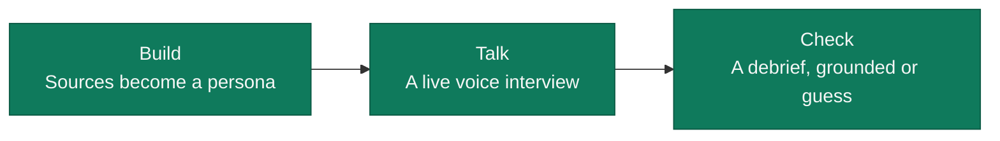

<div align="center">

<picture>
  <source media="(prefers-color-scheme: dark)" srcset="assets/presentations/logo/opentwin-icon.svg" width="96" height="96">
  
</picture>

# OpenTwin

**It tells you what it knows. And what it's guessing.**

Turn real interview material into an AI test user, talk to it live, and see which findings rest on a quote from your sources.

[Open the live app](https://baselhack26-t3-web.vercel.app) · creating personas, live interviews and debriefs need the team link

</div>

<!--
  SCREENSHOTS GO HERE.
  Add the debrief first, with both grounded and guess labels in view.
  No image files exist yet. Use fictional data and never show a passcode.
-->

## Why

Design sprints move faster than user research. AI test users can fill the gap, but they sound just as sure when they make something up. OpenTwin shows you the difference, so you know which answers rest on your material and which are the model's guess.

## How it works



- **Build.** Add transcripts, notes, PDFs or images. OpenTwin turns them into a persona with jobs, pains and objections, each labelled grounded or guess, plus a readiness score. Check it against your test goal, answer any gap questions, and edit it by hand.
- **Talk.** Check your interview guide against The Mom Test, then interview the persona by voice, with a talking avatar. Share a prototype and the persona gets regular stills of your screen.
- **Check.** Read a debrief per question, with verbatim quotes and a label on each finding. Export it as Markdown or share it by link.

## What makes it different

Labels are checked in code. The model's own label is never trusted.

| Label | Meaning |
|---|---|
| **grounded** | The code found the cited quote in a source. You still judge whether it supports the claim. |
| **guess** | The code found no verified quote for this. It may still be useful, but treat it as a hypothesis. |

- **Persona:** evidence is kept only if its quote really occurs in a source. A fact without kept evidence becomes a guess ([`ground_draft`](code/backend/app/routers/personas.py)).
- **Debrief:** a finding stays grounded only if it restates a grounded persona fact and contains that fact's source quote. Otherwise it becomes a guess ([`_source_label`](code/backend/app/debrief.py)).
- **Quotes:** a finding whose quote the persona did not say is dropped ([`_place_quote`](code/backend/app/debrief.py)).

## Stack

| Part | Built with |
|---|---|
| Persona, guide check, debrief | OpenAI Responses API, default `gpt-5.4-mini` |
| Live voice | OpenAI Realtime over WebRTC, default `gpt-realtime-2.1-mini` |
| Live transcript | `gpt-4o-mini-transcribe` |
| Avatar | Simli |
| App | Next.js 16, React 19, Tailwind 4, FastAPI on Python 3.12 |
| Storage and hosting | Upstash Redis, Vercel |

The browser holds the call and connects straight to OpenAI and Simli. For the call, the backend only mints short-lived tokens and saves the transcript, because serverless functions can't hold a live connection.

## Run it locally

You need Node 20.9+, [uv](https://docs.astral.sh/uv/) and make. On Windows, use WSL.

```bash
cd code
cp .env.example backend/.env   # then fill in the keys below
make setup
make dev                       # app on http://localhost:3000
```

API docs are at http://localhost:8000/docs.

| Variable | Needed | What it does |
|---|---|---|
| `OPENAI_API_KEY` | Required | Personas, live voice and debriefs |
| `UPSTASH_REDIS_REST_URL` | Required | Storage; there is no in-memory fallback |
| `UPSTASH_REDIS_REST_TOKEN` | Required | Storage |
| `SIMLI_API_KEY` | Optional | Avatar; without it the call runs voice only |
| `SIMLI_FACE_ID` | Optional | Fallback face, used only when a persona has no usable face |
| `DEMO_PASSCODE` | Optional | Locally, the app is open without it. On Vercel it must be set |
| `OPENAI_MODEL` | Optional | Overrides the text model |
| `OPENAI_REALTIME_MODEL` | Optional | Overrides the live voice model |
| `OPENAI_REALTIME_VOICE` | Optional | Overrides the persona's voice |
| `OPENAI_REALTIME_EAGERNESS` | Optional | How quickly the persona replies |
| `OPENAI_REALTIME_NOISE_REDUCTION` | Optional | Noise reduction for the mic |
| `RATE_LIMIT_MULTIPLIER` | Optional | Loosens the hourly rate limits |

When deployed, the frontend also needs `BACKEND_URL`. Locally it defaults to http://localhost:8000.

## Limits

- This is a simulation, not real user feedback. Use it to sharpen questions and hypotheses, not to replace talking to people.
- The demo data in this repo is synthetic or anonymised.
- Sources go to OpenAI, and the call goes directly from your browser to OpenAI and Simli. Camera stills go to OpenAI, and a persona photo goes to Simli if you make a custom face from it. That face stays with Simli. Data in our own store expires after 7 days.

## Contributing

Read [`documentation/ONBOARDING.md`](documentation/ONBOARDING.md), [`documentation/PLAYBOOK.md`](documentation/PLAYBOOK.md) and [`CLAUDE.md`](CLAUDE.md). The API contract is [`code/shared/schema.json`](code/shared/schema.json).

From `code/`, run `make fix` and `make check` before you push. CI also runs `make smoke` and `make e2e`. `make eval` scores the prompts with real OpenAI calls, costs money and never runs in CI.

---

<p align="center">Built at BaselHack 2026.</p>
